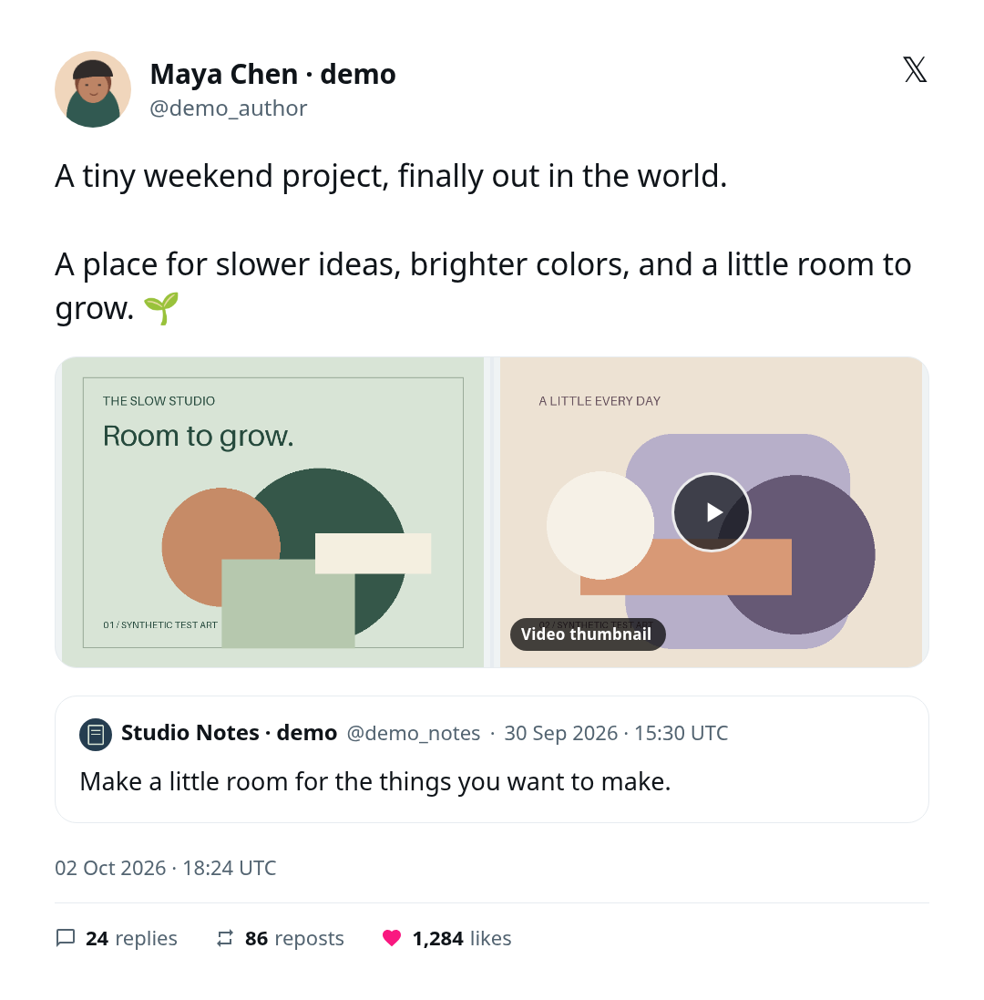
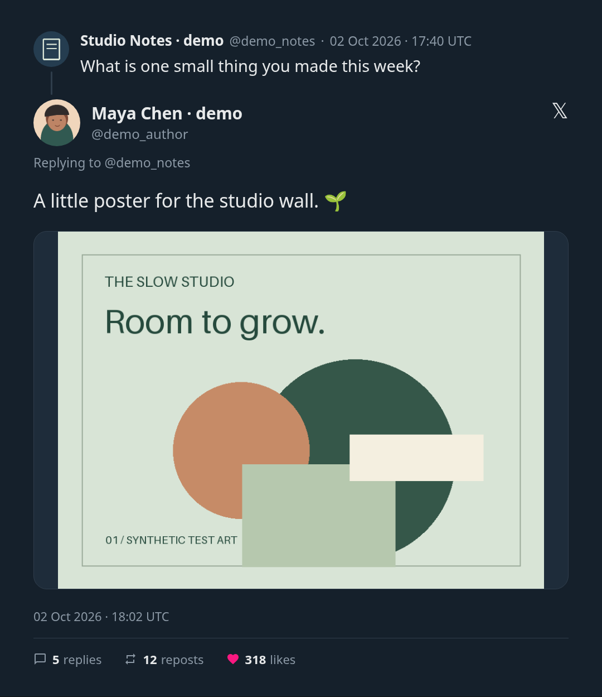
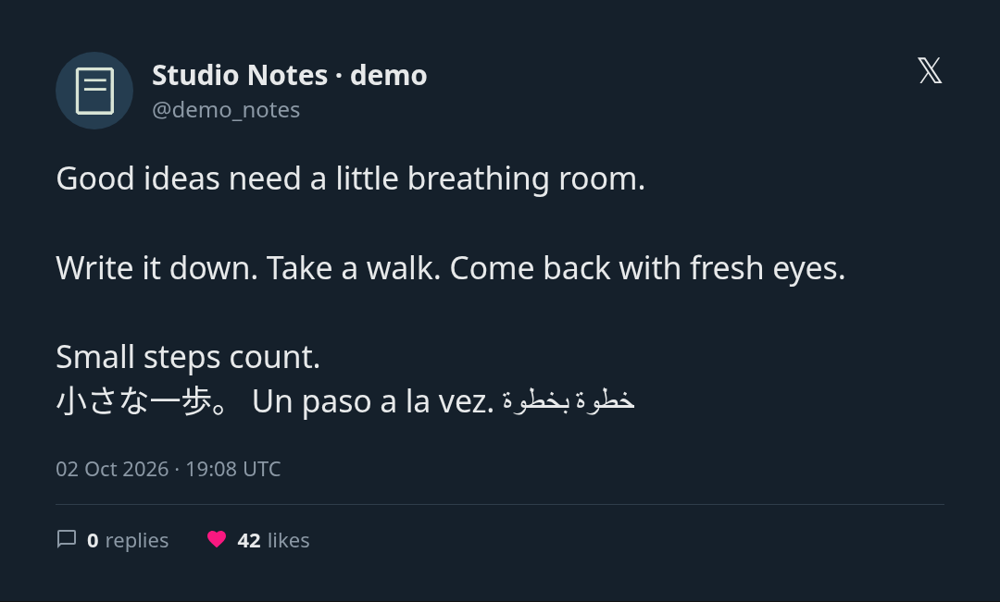

# X to Image · Telegram Bot

A self-hosted Telegram bot that turns a public X/Twitter post link into a clean image card. The card shows the author, full text, photos, quoted post and, for replies, the post being replied to.

<p align="center">
  
  
</p>

<p align="center">
  
</p>

<sub>Demo cards use fictional fixture data. Regenerate them with <code>uv run python scripts/render_demo.py</code>.</sub>

This project was inspired by the **link → image** flow on xtoimage.com, but it's a separate implementation. It doesn't call that site or use its code or assets, and it has no public gallery. It isn't affiliated with X, Telegram, FxEmbed or xtoimage.com.

## Features

- Accepts `x.com` and `twitter.com` status links, including mobile and `/i/status/` URLs
- Shows the author's name, handle and avatar, the full post text, the timestamp, and reply/repost/like counts
- Shows up to four photos or video thumbnails and one quoted post
- For replies, shows the replied-to post above the reply with a connecting line and a "Replying to @handle" label
- Has light and dark themes, plus a full-quality PNG download with `/file`
- With `/video`, plays a post's video or GIF inside the card, with sound for videos
- Uses Noto fonts in the Docker image, so emoji, CJK and RTL scripts render correctly
- Gives clear error messages for deleted or protected posts, provider failures, oversized posts and rate limits
- Supports an optional allowlist of user IDs and only answers private chats by default
- Has no database and keeps no image history

**What it doesn't do:** Videos appear as still thumbnails, except with `/video`, which plays one clip (up to 60 seconds). Threads longer than the direct parent, polls, articles, link cards and nested quotes aren't fully reproduced, and the caption says when something is left out. Posts over 12,000 characters or taller than 6,000 px are rejected rather than cropped. The images are fixed snapshots and won't change if the post is edited or deleted.

## Quick start (Docker)

1. Create a bot with [@BotFather](https://t.me/BotFather). Keep the token private.
2. Clone this repo and run `cp .env.example .env`.
3. Set `TELEGRAM_BOT_TOKEN` in `.env`. The default `POST_PROVIDER=fxtwitter` doesn't need an X key.
4. Set `ALLOWED_USER_IDS` to your numeric Telegram ID. If you don't know it, start the bot, send `/id`, then add the ID and restart. If you leave the list empty, anyone who finds the bot can use it in private chats.
5. Start the bot:

```sh
chmod 600 .env
docker compose up --build -d
docker compose logs --tail=50 -f bot
```

Then open your bot in Telegram and send it a post link. To stop it, run `docker compose down`.

The bot uses long polling, so it needs no webhook, open port or domain. It does need a machine that stays on. Run only one instance per bot token. If the token already has a webhook, the bot won't start; it never removes a webhook on its own.

## Commands

| Command | Result |
| --- | --- |
| a post URL, or `/image <URL>` | Sends the card as a photo |
| `/file <URL>` | Sends the original PNG as a file (Telegram compresses photos) |
| `/video <URL>` | For a post with a video or GIF, sends the card as a video with the clip playing in place of its thumbnail |
| `/theme light` / `/theme dark` | Sets your theme until the bot restarts |
| `/id` | Shows your numeric Telegram user ID |
| `/privacy` | Explains how links and images are handled |
| `/help`, `/start` | Shows usage and limits |

Each result includes a button that opens the original post on X.

### `/video`

`/video` renders the same card as `/image`, then plays the clip where its thumbnail would be. The card's rounded corners and layout stay the same.

- It uses the first video or GIF in the post. If the post has none, it uses one from the quoted post, then the replied-to post. Any other videos stay as still thumbnails.
- Videos keep their sound. GIFs are sent as Telegram animations, so they loop and have no sound.
- Clips longer than 60 seconds are cut to the first 60 seconds, and the caption says so.
- Cards taller than 1920 px are scaled down to that height for the video.
- The bot downloads one MP4 of up to 40 MB from `video.twimg.com`, picking the best one at 2.5 Mbit/s or less (usually 720p) when there's a choice.
- It needs `ffmpeg`. The Docker image includes it. For native installs, install it (`apt install ffmpeg`) or set `FFMPEG_EXECUTABLE_PATH`. Without it, `/video` replies that video isn't set up, and everything else still works.

## Post providers

### FxTwitter / FxEmbed (default)

`POST_PROVIDER=fxtwitter` uses the public [FxEmbed v2 status API](https://docs.fxembed.com/api/twitter/operations/2statusid/), which doesn't need an X account. The bot sends it the post ID and downloads images from `pbs.twimg.com`.

- For a reply, the bot makes a second request to get the parent post. If that request fails, the reply still renders and the caption says so.
- Text comes from the provider's display field, so hidden media and quote links don't show up as stray `t.co` URLs.

FxEmbed is an unofficial third-party service with its own rate limits and uptime. It can break when X changes. This project doesn't log in to X, scrape protected content or get around access controls.

### Official X API

```dotenv
POST_PROVIDER=x_api
X_BEARER_TOKEN=your-token-kept-private
```

This option needs your own [X developer access](https://docs.x.com/x-api/introduction). The parent post comes back in the same response through the `referenced_posts` expansion, so replies don't cost an extra request. The adapter handles both the current `post.fields` format and the older tweet-shaped format. It's tested against fixtures only, so check it with a real request before relying on it. The bot never falls back to FxEmbed.

## Configuration

All settings come from environment variables. See [`.env.example`](.env.example).

| Variable | Default | Notes |
| --- | --- | --- |
| `TELEGRAM_BOT_TOKEN` / `_FILE` | — | Required. Set only one of the two. |
| `POST_PROVIDER` | `fxtwitter` | `fxtwitter` or `x_api` |
| `X_BEARER_TOKEN` / `_FILE` | — | Required for `x_api` |
| `ALLOWED_USER_IDS` | empty | Comma-separated numeric IDs. If empty, anyone can use the bot. |
| `PRIVATE_CHATS_ONLY` | `true` | Set to `false` to allow group chats |
| `DEFAULT_THEME` | `light` | `light` or `dark` |
| `MAX_CONCURRENCY` | `2` | Renderer job limit (1–4). Polling stays sequential, so raising this doesn't increase throughput. |
| `USER_COOLDOWN_SECONDS` | `10` | Minimum wait between one user's requests |
| `CHROMIUM_EXECUTABLE_PATH` | — | Uses a system Chromium (native installs only) |
| `FFMPEG_EXECUTABLE_PATH` | `ffmpeg` on `PATH` | The ffmpeg used by `/video` (native installs only) |

The `_FILE` variants read a secret from a mounted file. For Docker, add a read-only mount in Compose. Never build secrets into the image or commit `.env`.

**Built-in limits:** The bot handles one update at a time, with up to 32 updates queued. A conversion times out after 90 seconds (240 seconds for `/video`) and a network request after 20 seconds (60 seconds for a video download). Provider responses are capped at 2 MB, and source images at 8 MB and 16 megapixels.

## Running without Docker

You need Python 3.12 or 3.13 and [uv](https://docs.astral.sh/uv/).

```sh
uv sync --locked --group dev
uv run playwright install --with-deps chromium
export TELEGRAM_BOT_TOKEN=...   # the Python entrypoint does not read .env
uv run xtoimage-bot
```

Install `fonts-noto-color-emoji` and `fonts-noto-cjk` (Debian/Ubuntu) for emoji and CJK text, and `ffmpeg` for `/video`. Run the bot under its own unprivileged user. The API client respects `HTTPS_PROXY` and `ALL_PROXY`.

## Security and privacy

- **Links are never opened.** The bot reads the post ID from the URL and only contacts the provider API and `pbs.twimg.com`, plus `video.twimg.com` for `/video`. It doesn't follow redirects or fetch media from other hosts.
- **Videos are handled narrowly.** For `/video`, only plain MP4 files are accepted, never streaming playlists. ffmpeg is told the file is an MP4, so it doesn't guess the format, and it may only read local files. It runs one job at a time with a time limit, and its output is never logged.
- **Images are cleaned before use.** Each one is decoded, size-checked and re-encoded as PNG, which removes its metadata.
- **The renderer is isolated.** Post text is HTML-escaped, and JavaScript, network access and service workers are turned off in the browser. Only checked inline PNGs are drawn.
- **The container is locked down.** It runs as an unprivileged user with a read-only filesystem and no extra capabilities, and `/tmp` is temporary memory storage. Don't rely on Chromium's sandbox as a security boundary, and keep the image updated.
- **No post or image archive is kept.** Cooldowns and theme choices stay in memory, with a size limit. Chromium may write temporary profile and cache files under `/tmp`, which are removed when the browser closes. `/video` writes the card, the clip and the result to a temporary folder under `/tmp` and deletes it as soon as the video is made. The Compose setup keeps `/tmp` in memory, but a native install writes these files to disk. Logs don't include tokens, URLs, message text or raw exceptions.
- **Some data does leave the bot.** The post ID goes to the chosen provider, and the finished image or video goes to Telegram and the people in the chat.

Only share content you have the right to use, and keep the attribution. See X's [display requirements](https://docs.x.com/developer-terms/display-requirements), [developer guidelines](https://docs.x.com/developer-guidelines) and [terms](https://x.com/en/tos). Because an image doesn't update after a post is edited or deleted, the person running the bot is responsible for handling removal requests.

## Development

```sh
uv run ruff check . && uv run ruff format --check .
uv run mypy src
uv run pytest -q
uv run python scripts/render_demo.py   # writes docs/examples/*.png
```

The tests cover:

- URL parsing and blocking of unexpected hosts
- Redirect and payload limits
- FxEmbed and X API fixtures
- Missing quotes and missing parent posts
- HTML escaping
- Rendering in a real Chromium browser
- Making `/video` clips with a real ffmpeg, including keeping the card's rounded corners
- The full python-telegram-bot pipeline against a fake Telegram server

The tests don't need credentials or make any live X or Telegram requests. The browser tests need Chromium, and the video tests need ffmpeg; each is skipped if it's missing. CI runs lint and type checks, runs the tests, and builds the Docker image and smoke-tests it.

### Project layout

| Path | Contents |
| --- | --- |
| `src/xtoimage_bot/bot.py` | Commands, access checks, rate limiting and sending results |
| `src/xtoimage_bot/providers.py` | FxEmbed and X API adapters, including parent-post lookup |
| `src/xtoimage_bot/urls.py`, `network.py`, `media.py` | URL parsing, network requests and image checks |
| `src/xtoimage_bot/render.py` | Card HTML and the Chromium screenshot step |
| `src/xtoimage_bot/video.py` | `/video`: picking the clip and combining it with the card using ffmpeg |
| `scripts/render_demo.py` | Renders the demo cards from offline fixtures |
| `tests/` | Offline fixtures and integration tests |
| `Dockerfile`, `compose.yaml` | Self-hosting setup |
